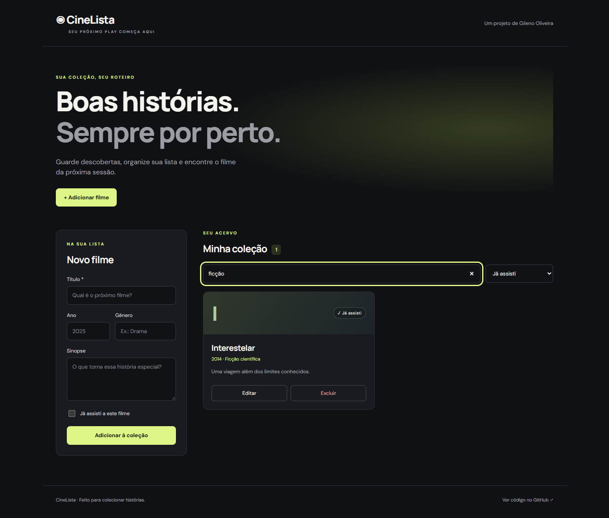

# CineLista: catálogo de filmes

Aplicação web para organizar filmes que você quer assistir e os que já viu. O projeto reúne uma interface responsiva em HTML, CSS e JavaScript e uma API REST com persistência em MongoDB.

Construído por [Gileno Oliveira](https://github.com/Noobdf) como projeto de estudo e portfólio.



## Funcionalidades

Cadastrar, listar, consultar, editar e excluir filmes.

Registrar título, ano, gênero, sinopse e status de assistido.

Buscar por título ou gênero e combinar a busca com filtros de status.

Confirmar a exclusão antes de remover um registro.

Exibir estados de carregamento, coleção vazia e erros de conexão.

Validar entradas no servidor e persistir os dados em MongoDB.


## Tecnologias e organização

Node.js 22+, Express 5 e Mongoose 8. A interface usa JavaScript sem framework e chama a API na mesma origem. Fontes do Google Fonts são opcionais; há fontes alternativas locais.

```text
app.js                       # Express, arquivos estáticos e tratamento de erros
index.js                     # Conexão com MongoDB e inicialização do servidor
rsc/models/filme.js           # Modelo e validações do banco
rsc/routes/filmes.routes.js   # CRUD e validação das requisições
public/                      # Interface web
test/filmes.test.js           # Testes HTTP com MongoDB temporário
```

## Executar localmente

Requisitos: Node.js 22 ou superior e MongoDB local em execução, ou uma conexão MongoDB Atlas.

```sh
git clone https://github.com/Noobdf/WS.git
cd WS
npm ci
```

Copie `.env.example` para `.env`:

```powershell
# Windows PowerShell
Copy-Item .env.example .env
```

```sh
# Linux ou macOS
cp .env.example .env
```

Ajuste o arquivo se necessário:

```dotenv
PORT=3000
MONGODB_URI=mongodb://127.0.0.1:27017/catalogo_filmes
```

```sh
npm start
# Desenvolvimento com reinicialização automática:
npm run dev
```

Abra **http://localhost:3000**. O servidor só começa a aceitar conexões depois que o banco está disponível. O arquivo `.env` é ignorado pelo Git.

## API REST

| Método | Rota | Resultado |
| --- | --- | --- |
| GET | `/api/filmes` | Lista filmes, dos mais recentes para os mais antigos. |
| GET | `/api/filmes/:id` | Consulta um filme. |
| POST | `/api/filmes` | Cadastra e retorna o filme com status 201. |
| PUT | `/api/filmes/:id` | Atualiza os campos enviados; título obrigatório. |
| DELETE | `/api/filmes/:id` | Exclui e retorna status 204, sem corpo. |

Envie `Content-Type: application/json` nas operações de cadastro e edição.

```json
{
  "titulo": "Interestelar",
  "ano": 2014,
  "genero": "Ficção científica",
  "sinopse": "Uma viagem além dos limites conhecidos.",
  "assistido": false
}
```

Exemplo de cadastro com curl:

```sh
curl -X POST http://localhost:3000/api/filmes -H "Content-Type: application/json" -d '{"titulo":"Interestelar","ano":2014,"assistido":false}'
```

Resposta:

```json
{
  "error": false,
  "filme": {
    "_id": "ID_GERADO_PELO_MONGODB",
    "titulo": "Interestelar",
    "ano": 2014,
    "genero": "",
    "sinopse": "",
    "assistido": false,
    "atores": [],
    "premiacoes": [],
    "createdAt": "DATA_DE_CRIACAO",
    "updatedAt": "DATA_DE_ATUALIZACAO"
  }
}
```

O título deve ter de 1 a 150 caracteres após remover espaços das pontas. Ano aceita inteiro de 1888 a 2100 ou `null` para limpar o valor; gênero aceita até 60 caracteres e sinopse até 2000. `assistido` aceita apenas booleano. Campos desconhecidos são rejeitados. Os campos anteriores `atores`, `detalhes` e `premiacoes` continuam disponíveis pela API e são preservados quando omitidos na edição.

Erros retornam `{ "error": true, "message": "Descrição do erro" }`: 400 para entrada ou ID inválido, 404 para filme ou rota inexistente, 413 para corpo acima de 100 KB e 500 para falha interna.

## Testes

```sh
npm test
```

Os testes fazem requisições HTTP reais e usam `mongodb-memory-server` para iniciar um MongoDB temporário isolado. Na primeira execução, é necessário acesso à internet para baixar o binário do MongoDB. Os testes não usam o banco configurado no `.env`.

Cobrem o ciclo completo de CRUD, persistência, entradas inválidas, atualização sem perder campos anteriores, IDs inválidos, registros inexistentes, JSON malformado e entrega da interface.

## Decisões e limites

O servidor e a conexão com o banco ficam separados para facilitar testes.

IDs do MongoDB identificam os filmes, inclusive quando existem títulos iguais.

A API aplica uma lista de campos permitidos e não recebe operadores de atualização do cliente.

Busca e filtro são combinados na interface; para catálogos maiores, o próximo passo é busca e paginação no servidor.

Este catálogo é compartilhado e ainda não possui autenticação. Uma versão com contas deve incluir autenticação e autorização antes de permitir alterações por usuários distintos.

A versão anterior atendia a API na raiz `/`. Nesta versão, a interface ocupa `/` e a API fica em `/api/filmes`.

O banco padrão mudou de `netflix` para `catalogo_filmes`. Para continuar usando os dados anteriores, configure `MONGODB_URI=mongodb://127.0.0.1:27017/netflix` no `.env`.


## Próximos passos

Adicionar paginação e busca no servidor.

Criar contas e coleções por usuário.

Publicar uma demonstração com ambiente e dados de exemplo.

